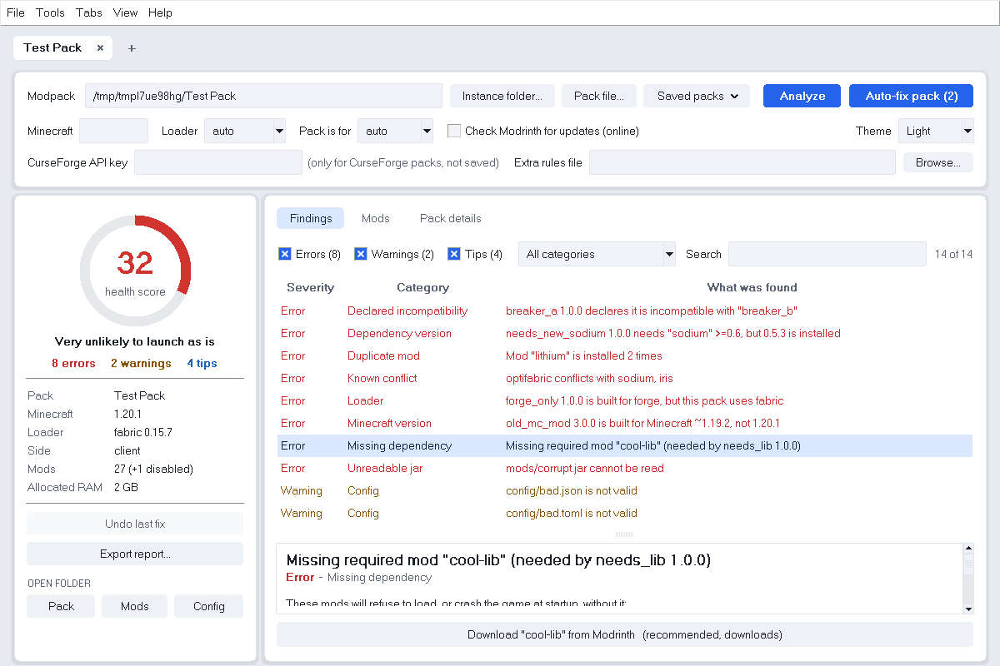

# Modpack Doctor

> **Found a bug or have a suggestion?** All issues should be submitted at **https://relay.darkmoonhollow.xyz**
> (not on GitHub). Include the exported report (**Export report...**) and your Minecraft version and loader.

Scan a Minecraft modpack and find out what is wrong with it, why, and how to fix it, in one click.
Works with **Forge, NeoForge, Fabric and Quilt** packs. Free and open source (MIT).



## What it does

- Finds **missing or wrong-version dependencies**, mods built for the wrong Minecraft version or loader, **duplicate mods**
  and **known conflicts** (for example OptiFine next to Sodium).
- Spots **broken config files** and risky settings, and suggests **RAM** for the size of your pack.
- Recommends **performance mods** you are missing (Sodium/Embeddium, Lithium, FerriteCore, ModernFix and friends).
- Gives you a **health score** and a plain-language explanation for every problem.
- **Auto-fix** applies the safe fixes for you. Mods are never deleted (they are renamed to `.jar.disabled`), config files
  are backed up first, and everything can be **undone**.
- Keeps several packs open in **tabs**, remembers them, and lets you **save packs** for one-click re-opening.
- Light and dark mode.

---

## Get it

You need **Python 3.11 or newer** from [python.org](https://www.python.org/downloads/). On Windows tick **"Add python.exe to PATH"**
in the Python installer. Nothing else needs installing: the app uses only Python's standard library.

### Easiest: the single file

1. Open the **Releases** page of this repository (right-hand column) and download **`ModpackDoctor.pyzw`** from the newest release.
2. **Windows:** double-click it. **Any system:** run `python ModpackDoctor.pyzw`.

That one file is the whole app. Keep it anywhere; delete it to remove the app (settings live in `~/.modpack_doctor`).
On Debian/Ubuntu Linux install the window toolkit once first: `sudo apt install python3-tk`.

### From the source code

1. On this page click the green **Code** button, then **Download ZIP**, and unzip it anywhere.
   (Or, if you use Git: `git clone <repository address>`.)
2. Start the app:
   - **Windows:** double-click **`ModpackDoctor.pyw`**.
   - **Any system**, from a terminal opened inside the unzipped folder: `python -m modpack_doctor`

Prefer a command? From the unzipped folder, `pip install .` adds a `modpack-doctor` command:

```
modpack-doctor            # opens the app
modpack-doctor analyze "C:\path\to\instance"
```

---

## How to use it

1. **Open a pack.** Click **Instance folder...** and pick your modpack's folder (the one that contains `mods`), or
   **Pack file...** for a downloaded `.mrpack` or CurseForge `.zip`. You can also paste a path into the box.
2. Press **Analyze** (or **F5**). Every problem is listed with its severity: *Error* (will probably crash), *Warning*, or *Tip*.
3. **Click a problem** to read what it means and what to do. Buttons under the explanation fix that one thing.
4. Or press **Auto-fix pack** to apply all the safe fixes at once. It tells you what it will do and asks first, then re-checks the pack.
5. Not happy with the result? Press **Undo last fix**. An Auto-fix run is undone as one step.
6. Use **Export report...** to save the findings as Markdown, text or JSON, for example to share when asking for help.

### After a crash

Open the **Crash log** tab (or press **Ctrl+L**) and click **Analyze latest crash**. It reads the newest file in the
pack's `crash-reports` folder (or `logs/latest.log`) and explains in plain words what went wrong: the suspected mod, missing
or wrong-version dependencies, a Mixin that failed, out-of-memory, or a Java version that is too old. Mods it can match to a
jar get a **Disable** button. Use **Open a crash file...** to read any report you have saved, or **Paste text or link...** to analyze a crash that
a player sent you: paste the report or log text, or an `mclo.gs` link (only `api.mclo.gs` is contacted, and only then). It understands the common
Forge, NeoForge, Fabric and Quilt formats; treat the result as a strong hint, not proof.

### Disabled mods, mod lists

- **Tools > Manage disabled mods...** lists every `.jar.disabled` file and turns the ones you pick back on. It can be undone
  like any other fix, and it never overwrites a jar that already exists.
- **Export list...** on the Mods tab (or **File > Export mod list...**) saves the mod table as CSV (opens in Excel) or a
  Markdown table for forum posts. **Save as .txt** (next to it) writes a plain one-mod-per-line list. **Help > Keyboard shortcuts** shows every shortcut.

**Where to find your instance folder:**

| Launcher | Folder |
|---|---|
| Prism / MultiMC | right-click the instance > **Folder** (then pick `.minecraft` or the folder above it) |
| CurseForge app | instance > **...** > **Open Folder** |
| Modrinth app | instance > **Open folder** |
| Server | the folder with `mods` next to `server.properties` |

### Understanding a problem (for pack makers and mod developers)

Click a problem and look at **Where this comes from**. It names the check that raised it, the jar, the metadata file
inside it, and the exact entry (for example `mods/needs-lib.jar > fabric.mod.json > depends."cool-lib"`). Rule-based findings
point at the entry in `rules.json`. Three buttons sit under every problem that has files:

- **Show jar in folder** selects the jar in Explorer/Finder.
- **View metadata files...** opens the raw `fabric.mod.json`, `mods.toml` and friends from inside the jar. A file the scanner
  could not read is marked, and the line its parser complained about is highlighted.
- **Copy debug info** puts a JSON bundle on the clipboard (finding, trace, file hashes, which metadata files parsed, tool
  version; your home folder name is hidden) for pasting into a bug report. Exported Markdown reports include the trace too.

**Metadata problems.** *Part of this jar's mod metadata could not be read* usually means a second loader's file inside the jar is
slightly malformed while the mod's main metadata is fine. Modpack Doctor never edits files inside mod jars (that could break the
mod). Instead you can **Ignore this warning** (hides it for this pack; *Undo last fix* or *Tools > Show ignored warnings again*
brings it back) or **Disable this jar** when nothing in it could be read. Errors can't be ignored.

### What you can open

| Input | Notes |
|---|---|
| **Instance folder** | Any folder with `mods/` in it. Minecraft version, loader and RAM are read from the launcher's files when present. |
| **Modrinth `.mrpack`** | Mods are downloaded from the hosts the format allows, checked against the pack's hashes, and analysed. |
| **CurseForge pack `.zip`** | These only *list* mods, so downloading them needs a free API key from [console.curseforge.com](https://console.curseforge.com) (paste it into the app; it is never saved). Without a key only the mods bundled in the pack are analysed, and the app says so. |

Packs from files are unpacked into `~/ModpackDoctor/workspaces/`. Your original file is never changed.

### Tabs and saved packs

- Every pack opens in its own **tab** with its own results and undo history. **Ctrl+T** new tab, **Ctrl+W** close,
  **Ctrl+Shift+T** reopen a closed tab, **Ctrl+Tab** switch, **Ctrl+1..9** jump. Right-click a tab to rename or duplicate it.
- Your tabs **come back when you reopen the app** (File > *Reopen my tabs on startup* turns this off).
- **Saved packs** (button next to *Pack file...*, or **Ctrl+D**) remembers a pack and its settings under a name you choose.
  A **Recent** list keeps the last ten.
- **Mods / Config / Pack** buttons (left panel, **Ctrl+M** and **Ctrl+Shift+C**) open those folders in your file manager.

### Options

Leave **Minecraft**, **Loader** and **Pack is for** on *auto* unless the result looks wrong. Tick **Check Modrinth for updates**
to also look for newer builds and replacements online. Choose **System / Light / Dark** with the *Theme* box.

---

## Command line

```
python -m modpack_doctor analyze <folder|.mrpack|.zip> [--format text|markdown|json] [--out report.md] [--online]
python -m modpack_doctor fix <folder> [--yes]
python -m modpack_doctor undo <folder>
python -m modpack_doctor gui <folder> [<folder> ...]      # opens the app, one tab per pack
```

`analyze` exits with code 1 when errors are found, so it works in CI. Try it safely on a deliberately broken sample pack:

```
python tools/make_demo_pack.py demo-pack
python -m modpack_doctor gui demo-pack
```

## Safety

- Mods are **never deleted**, only renamed to `.jar.disabled` (rename back to restore).
- Edited config files are backed up first. All changes are logged in `.modpack_doctor/` inside the instance and can be undone.
- Downloads happen only from Modrinth and are hash-verified. Nothing is uploaded anywhere.
- Your CurseForge API key is never saved.

## Limits

- It reads mod **metadata**. It cannot detect every crash (for example mixin conflicts or code-level incompatibilities
  that no mod declares). Read a clean result as "no known problems", not "will run".
- Crash analysis only recognises the formats listed above; a crash with no named mod gets an honest "nothing points at a
  specific mod" rather than a guess.
- Config checks are rule-based (syntax plus the value rules in `rules.json`) and do not understand every mod's settings.
- The built-in known-conflict list is a starter set.

## Teach it more

Compatibility knowledge lives in `modpack_doctor/data/rules.json` (known conflicts, redundant mods, recommended mods, config
rules, RAM tiers). Add your own in a separate JSON file and pick it under *Extra rules file* in the app (or `--rules` on the
command line). Its lists are added to the built-in ones. Pull requests that extend `rules.json` are welcome.

---

## For developers

**Build the single file yourself:** `python tools/build_single_file.py` writes `dist/ModpackDoctor.pyzw` (a standard-library zipapp).

**Publish a release:** bump the version in `modpack_doctor/__init__.py` and `pyproject.toml`, commit, then push a tag:
`git tag v0.1.0` and `git push origin v0.1.0`. The *Release* workflow runs the tests, builds `ModpackDoctor.pyzw` and
attaches it to a new GitHub Release (GitHub adds the source ZIP automatically). You can also create the release by hand on the
Releases page and drag the built file in.

```
python -m unittest discover -s tests            # engine tests; GUI tests are skipped without tkinter and a display
xvfb-run python -m unittest discover -s tests   # Linux: include the GUI tests
python tools/make_icon.py                       # redraws the app icon (needs Pillow)
```

## License

MIT. See [LICENSE](LICENSE).
